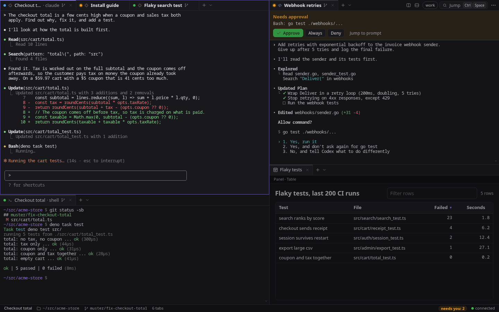
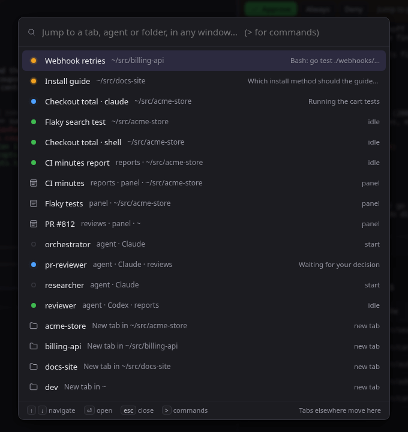
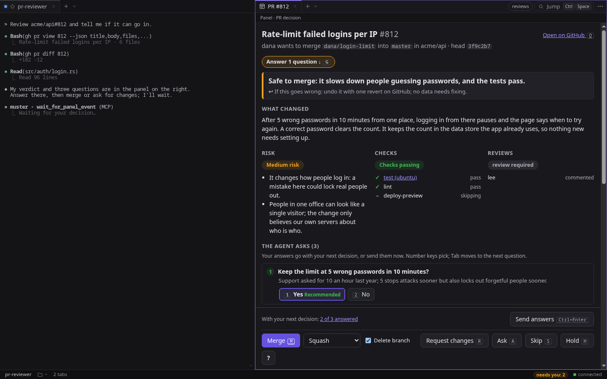
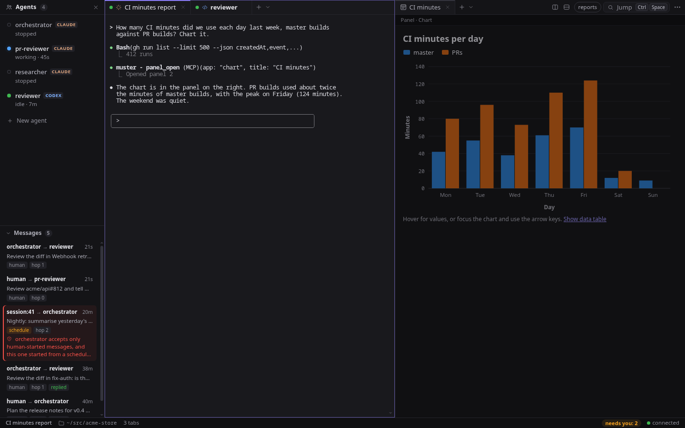
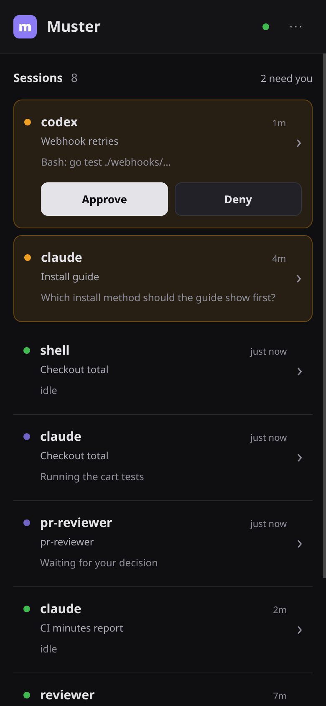

# Muster

Muster is a Linux desktop app for running several coding agents at once. Claude Code, Codex and
plain shells run side by side in real terminals, and Muster shows you which of them is waiting
for you.



It is for people who hand work to agents and keep three or four of them busy: one fixing a bug,
one writing a guide, one reviewing a pull request. With ordinary terminal tabs you keep cycling
through them to find the one that stopped for a permission prompt, and closing the window ends
every session in it. In Muster each agent's state is on its tab, the one that needs you is a
key press away, and the terminals keep running when the window closes.

## What you get

- **A tiling window for agents.** Split the window into groups, each with its own tabs, and drag
  tabs between groups and windows. Each tab is one task in a folder you pick, optionally in its
  own git worktree (Ctrl+Shift+N). A shell opened next to an agent (Alt+D) works in the same
  folder. Tabs name themselves from what the agent is doing.
- **You see who needs you.** Every tab has a state dot: working, idle, needs approval, asking a
  question, stuck, exited. A banner above a waiting agent's terminal has Approve, Always and Deny
  (Alt+A approves). Alt+J jumps to the next agent that needs you in any window, the status line
  counts them, and a desktop notification tells you when one needs approval, asks a question or
  gets stuck.
- **Jump to anything.** Ctrl+Space searches every tab, panel, named agent and recent folder in
  every window. Agents that need you come first.

  

- **Terminals that outlive the window.** A separate terminal host owns the processes. Close the
  window, reload the UI or restart the backend, and every agent keeps running; reopen and the
  scrollback replays.
- **Panels beside the agent.** Agents can open Markdown, images, charts, tables and pull request
  decisions next to their terminal, and you answer with a click. In a PR decision panel you see
  the agent's verdict, how to undo the change, the risk, the checks and the questions it has for
  you, then merge, request changes or ask. The agent merges only after you press Merge and
  confirm.
  `muster skills install` teaches Claude Code and Codex how to use panels.

  

- **Named agents that remember.** Give an agent a name, a persona and a folder of memory files,
  and it resumes its conversation each time you start it. The agents panel (Alt+G) starts them,
  edits their persona and memory, and shows the messages agents send each other.

  

- **Agents that drive other agents.** Every agent gets Muster's MCP tools: it can list sessions,
  start a helper, send it a prompt, wait for it to finish and read its screen. The `muster` CLI
  does the same from any shell.
- **A phone view.** Pair a phone over Tailscale with `muster pair` to see which agents need you,
  approve or deny, send a prompt and watch a terminal.

  

## Quick start

You need Linux, a Rust toolchain, [Deno](https://deno.com), and the `claude` or `codex` CLI
installed and logged in. The native window needs webkit2gtk-4.1; without it, build the browser
version and Muster opens in Chromium, Chrome or Brave instead.

```sh
deno task build:all       # the UI, then the release build with the native window
install -m755 target/release/muster target/release/muster-terminal-host ~/.local/bin/
muster                    # starts the daemon in the background and opens a window
```

The first window asks for a folder. Type one (Tab completes), then pick Claude, Codex or Shell.
From there:

| Keys | What it does |
|---|---|
| Alt+T | New tab in the same folder |
| Alt+D | Shell beside the current agent, in a new group |
| Ctrl+Shift+N | New tab in its own git worktree |
| Alt+J | Go to the next agent that needs you |
| Alt+A / Alt+Shift+A | Approve / deny the focused agent's prompt |
| Ctrl+Space | Jump to any tab, agent or folder |
| Alt+G | Agents panel |
| Alt+/ or F1 | Every shortcut |

Run `muster skills install` once so your agents know how to open panels. The full UI spec,
including every shortcut, is in [docs/UI.md](docs/UI.md).

## Run

```sh
muster                           # start the daemon if needed, then open a new window
muster open [path] [--window N]  # open window N, or a new window with a tab in path
muster status                    # is the daemon running? how many sessions?
muster url                       # print the UI URL (includes the access token)
muster reload                    # restart the backend, preserving terminal processes
muster stop                      # stop backend and host (terminates all sessions)
muster daemon [--foreground]
```

Each `muster` opens its own window and returns at once. Closing a window keeps its tabs; the
next `muster` reopens them.

Without the `gui` feature, the UI opens in the first browser found out of `$MUSTER_BROWSER`,
`chromium`, `google-chrome-stable` or `brave`, in `--app` mode with its own profile. If none
is found it falls back to `xdg-open`.

### Driving agents from a shell (or another agent)

```sh
muster ls                                # ID  WIN  TAB  NAME  KIND  STATE  FOR  DETAIL
muster new ~/src/app --prompt "fix the flaky test"   # prints the new session id
muster new . --kind codex -- -m gpt-6-sol            # args after -- go to the agent CLI
muster send fix-auth "run the tests" --wait          # prompt, then wait until it settles
muster read fix-auth -n 100              # last 100 lines of output, plain text
muster wait 12 --until needs_human       # block until it needs you (exit 124 on timeout)
muster approve 12                        # answer a permission prompt
muster keys 12 esc text:/compact enter
muster events --tab fix-auth             # one line per state change, until Ctrl-C (--json: every event)
```

A target is a session id, `.` (the session you're in), a session or tab name, a unique
prefix, or `tab/name`. Exit codes: 0 ok, 1 error, 2 bad or ambiguous target, 124 timeout.
See [docs/CLI.md](docs/CLI.md) for every command and [docs/MCP.md](docs/MCP.md) for the MCP
tools agents get.

Named agents are persistent agent sessions with their own folder, memory and resumed
conversation (PLAN.md §10): `muster agent new reviewer --persona "Reviews diffs"`, then
`muster ask reviewer "is fix-auth safe to merge?"` (or the `ask_agent` MCP tool from an agent).
In the UI, Alt+G opens the agents panel: start an agent with a click, create one from a
template, edit its persona and memory, and watch the messages agents send each other.

Agent panels are described in [docs/AGENT_PANELS.md](docs/AGENT_PANELS.md); the agent skills
that use them in [docs/CLI.md](docs/CLI.md#agent-skills).

## How it fits together

A small terminal host owns the PTYs and processes. The application backend handles agents,
tasks (the API calls them channels) and worktrees, and serves the UI; windows only render it.
Closing a window or restarting the backend leaves terminal processes running, and the UI
reconnects and replays scrollback. See [docs/TERMINAL_HOST.md](docs/TERMINAL_HOST.md) for the
separation design, [PLAN.md](PLAN.md) for the roadmap, [docs/PROTOCOL.md](docs/PROTOCOL.md) for
the client protocol and [docs/ANDROID.md](docs/ANDROID.md) for the phone view.

## Build

```sh
deno task build                      # web/dist, then cargo build --workspace --release (browser-window mode)
cargo build --workspace --release --features gui # native window (needs webkit2gtk-4.1 on Linux)
deno task build:all                  # web/dist, then the release build with the native window
```

Build and distribute both `muster` and `muster-terminal-host` side by side. Debug builds
serve `web/dist` from disk.

## Where things live

| What | Default | Override |
|---|---|---|
| Database, session logs, worktrees, agent homes (`agents/`) | `$XDG_DATA_HOME/muster` | `MUSTER_DATA_DIR` |
| Backend discovery/logs and terminal host socket/lock/log | `$XDG_RUNTIME_DIR/muster` | `MUSTER_RUNTIME_DIR` |
| Port | 7433 (a free port if busy on first launch; pinned thereafter) | `MUSTER_PORT` |
| Independent UI releases | `$MUSTER_DATA_DIR/ui/{releases,current}` | `MUSTER_WEB_DIR` (direct built UI override) |

Log verbosity: `MUSTER_LOG=debug`.

## Test

```sh
scripts/smoke.sh   # end-to-end: temp dirs, port 17433, scoped Deno permissions
```

## Operations and upgrades

### Updating a running install

Release builds can load an independent UI release, and the backend can be replaced without
touching the terminals:

```sh
deno task web
muster ui-install web/dist        # activate UI files, then refresh the window
muster reload                    # replace only the backend; terminal processes continue
```

UI installation switches complete releases atomically and keeps older bundles for open
windows. `MUSTER_WEB_DIR` can point directly to a built UI for development. An incompatible
UI is refused. Backend reload verifies host ownership and refuses legacy monolithic daemons;
existing terminals in those daemons need to finish before migrating.

### Executable snapshots

On startup, the backend snapshots its executables under the data directory and publishes
`bin/muster` atomically. Agent hooks and `$MUSTER_BIN` use that stable path, so removing
an old build directory does not strand running sessions. Later backend-only builds can
reuse the saved host executable. Publishing a build never replaces a running host;
old executable releases are retained for rollback.

### Native window renderer (Linux)

WebKitGTK's DMA-BUF renderer is much faster (typing feels instant) but crashes at startup on
many Wayland setups ("Error 71 (Protocol error)"). On Wayland with the NVIDIA driver, the
window keeps it on and sets `__NV_DISABLE_EXPLICIT_SYNC=1`, which makes it work there. Every
other setup keeps it off.

While such a window starts it keeps a file in `<data>/webkit-dmabuf-launching/` (one per
window process), and deletes it a few seconds after the page loads or when the window
closes normally. If the next window finds one left by a process that is gone (the previous
window crashed during startup), or a window's web process crashes during startup, Muster
writes `<data>/webkit-dmabuf-failed` (usually `~/.local/share/muster/webkit-dmabuf-failed`),
keyed by the NVIDIA driver and WebKitGTK versions. From then on windows use
`WEBKIT_DISABLE_DMABUF_RENDERER=1` until one of those versions changes or you delete the file.
The window that crashed is not reopened for you; open a new one.

Setting either variable yourself always wins (`env WEBKIT_DISABLE_DMABUF_RENDERER=0 muster`
forces the fast renderer on, `=1` off). `muster status` shows what the next window would use,
and each window logs its choice and any fallback to the daemon log.

### Downgrading

Downgrading to a monolithic build (one without `muster-terminal-host`) is an offline step:
run `muster stop` with this build first. That ends every terminal. An older daemon knows
nothing about host-owned terminals, so started beside them it would mark them exited and
autostart duplicate agents next to the originals. To prevent that, the terminal host holds
`daemon.lock` in the runtime directory while it lives, and an older daemon refuses to start
until the host is gone ("another muster daemon is already running").

## License

MIT, see [LICENSE](LICENSE).
