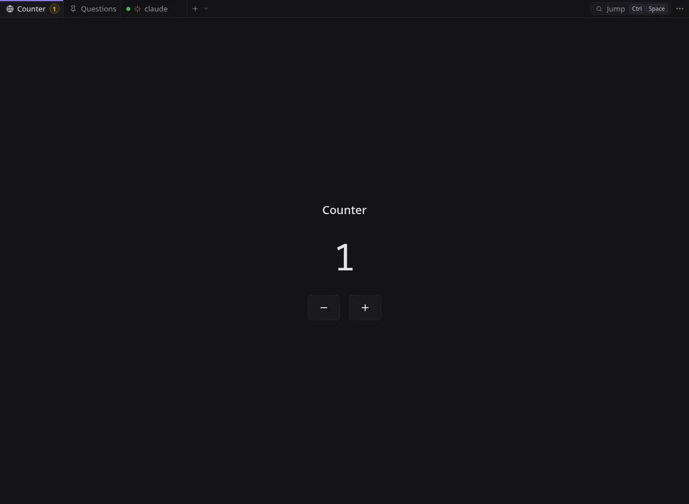
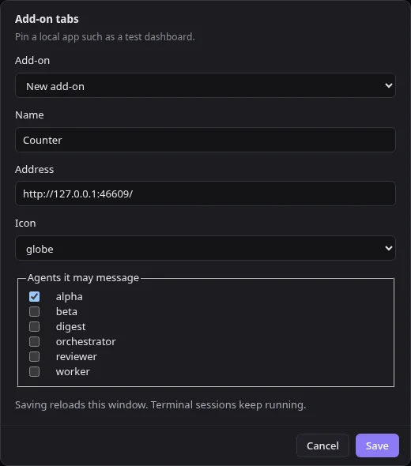

# Add-on tabs

An add-on is a local app such as a test dashboard, pinned beside Questions in the desktop window. Start the
app separately, open **Add-on tabs…** in the command palette or window settings menu, then enter its name,
address and icon. Tick only the named agents it may message and click **Save**. Saving or removing reloads
this window; terminal sessions keep running. Other open windows refresh the tabs, names and agent ticks
automatically. If an address was registered after a window loaded, its tab says “Reload the window to open
this add-on.” Use its **Reload** button. Each window keeps its own hidden tabs and each channel keeps their
places. Use the tab menu's **Hide** and the
palette's **Show Counter** to hide and restore the demo. The phone page does not show add-ons.






The registry is `addons.json` in the data directory. It is private local data, never a repository file. It
contains an array of `{id, name, url, icon, agents}`. IDs are lower-case letter/digit/hyphen slugs, 1–40 ASCII
characters, starting and ending with a letter or digit. The dialog assigns a stable ID. Names are 1–40
characters. Icons come from the existing icon list; the default is `globe`. Addresses use the same parser as
web previews: HTTP or HTTPS, `localhost` or `127.0.0.1`, a nonzero port, and neither of the daemon's own
ports. The parser supplies port 80 or 443 when omitted and stores the rebuilt URL. IPv6 literals, credentials
and other hosts are refused. An unreadable or invalid registry logs a warning and is moved aside as
`addons.json.bad-<timestamp>`; Muster starts with no add-ons.

The dialog saves the revision it opened with. If another window changes the registry first, saving or removing
is refused: “Changed in another window. Reopen Add-on tabs to see it.” Reopen the dialog before editing again.

Registry writes and message forwarding use the Questions window check: a local authenticated socket with the
window's origin, a claimed window, no session identity, and a connection attributed to a program outside
session process trees. There is no add-on MCP tool or command-line write command. Calls from the CLI, HTTP API
or a script are refused with:

> Add-on changes and messages are allowed only from Muster's window. Open Add-on tabs there.

This is the same window boundary used for Questions, not proof of a physical click. Processes with full access
to the owner's account remain outside this boundary's threat model.

## Frame and lifetime

The desktop directly frames the exact registered URL with
`sandbox="allow-scripts allow-same-origin allow-forms"` and `referrerpolicy="no-referrer"`. It
permits scripts and forms, with the app’s normal origin. Only `open-link` can open the system browser;
popups, top navigation and native window IPC are blocked. The desktop’s CSP admits the panel server’s `/proxy` and
`/preview` pages, `about:` frames, and registered origins; it retains `frame-ancestors 'none'`. The existing
native navigation rule reserves `/proxy` and `/preview` on `127.0.0.1` for the panel server; use `localhost`
or another path for an app using those routes. An add-on must permit the window's exact origin in its own
`frame-ancestors` response header, for example `frame-ancestors http://127.0.0.1:7433` when that is the window
origin. Omit an incompatible `X-Frame-Options` header. The app must be running when its frame loads.

Frames remain mounted while switching channels, moving tabs, hiding tabs, zooming and opening panels beside
them. The tab menu’s **Reload** retries just that add-on by loading its address again in the same frame node.
Reloading or closing the window reloads or ends all its frames. Saving the registry reloads the window so it
receives a fresh CSP. If a backend restart changes the panel-server origin, the window stays open and shows
“Muster's backend restarted. Reload this window to show panels and previews again.” in the update banner's
place. Its **Reload window** button uses the same action as Ctrl+Shift+R, including the unsaved-note guard.
There is no automatic reload; the banner disappears if the origin changes back to the one the page loaded
with. While an add-on frame has focus, keys go to the add-on. To leave fullscreen, use Muster’s own
**Exit fullscreen** button. Apps on the same origin share the browser’s normal same-origin trust.

## Message protocol

Every message is an object with `muster: 1` and `type`. The fields below are the complete allowlist; unknown
types, extra fields, missing fields and invalid values are silently ignored. Text lengths count Unicode
characters. Titles are rendered as text, never HTML. Muster accepts a message only when both
`event.source === iframe.contentWindow` and `event.origin === new URL(registeredUrl).origin`.

The add-on posts to `window.parent` with the **exact window origin** as `targetOrigin`. Configure that origin
explicitly: referrers are withheld. Never use `"*"`. The window likewise posts only to the add-on's exact
registered origin. An add-on should check the sender is its parent and has the configured window origin before
accepting a response.

| Add-on → window type | Additional fields                              | Behavior                                                                                                                            |
| -------------------- | ---------------------------------------------- | ----------------------------------------------------------------------------------------------------------------------------------- |
| `badge`              | `count`: integer 0–999                         | 0 hides it. It does not contribute to “needs you”.                                                                                  |
| `title`              | `text`: string, 0–60 characters                | Empty restores the registered name.                                                                                                 |
| `open-link`          | `url`: string, at most 2048 characters         | Parsed with URL; HTTPS only, without credentials. Opens the system browser. At most once per two seconds per add-on in this window. |
| `message-agent`      | `agent`: named agent, `text`: 1–300 characters | The daemon checks registration, the framed origin, the ticked agent and the text again, then forwards through normal agent delivery.                   |

Example from Counter:

```js
window.parent.postMessage({ muster: 1, type: "badge", count: 3 }, windowOrigin);
```

| Window → add-on type   | Additional fields                               | When                                                                                                                   |
| ---------------------- | ----------------------------------------------- | ---------------------------------------------------------------------------------------------------------------------- |
| `theme`                | `mode`: `"dark"` or `"light"`; `tokens`: object | Frame load and each theme change.                                                                                      |
| `focus`                | none                                            | The visible tab gains focus; also on load if focused.                                                                  |
| `visible`              | `visible`: boolean                              | Frame load and when it is shown or hidden.                                                                             |
| `message-agent-result` | `ok`: boolean; `error`?: string                 | After message forwarding succeeds or is refused. Success means accepted into delivery, not that the agent has replied. |

Theme tokens are exactly `--bg-0`, `--bg-1`, `--bg-2`, `--border`, `--text`, `--text-muted`, `--accent`,
`--font-ui` and `--font-mono`, with their computed CSS string values. No other settings or tokens are sent.

Agent messages start with sender and origin `addon:<id>` and hop 0. The window's tick grants the initial
recipient for that message only; `addon:` origins cannot be added to agent settings. Later replies retain the
origin and follow the existing recipient and hop rules. Existing spend and
daily message caps also apply. Replies appear in the agent message log, not in the add-on. There are at most
30 message attempts per add-on per rolling hour, shared across windows. The counter is kept in daemon
memory and resets when the backend restarts. Every refused forwarding attempt consumes that allowance too,
including stale origins, removed add-ons,
unticked or missing agents, and invalid text. The frame receives only these fixed errors:

- “Not sent: this agent isn't allowed.”
- “Not sent: limit of 30 an hour.”
- “Not sent: message must be 1-300 characters.”
- “Not sent.”

Agent lookup and delivery details are never returned to the frame.

The channel exposes only these messages. Add-ons cannot use it to read sessions, notes, questions, credentials
or other RPCs. Register only apps whose origin you intend to trust with the selected agents.

## Counter demo and checks

`web/dev/counter.html` is the only demo. The mock serves it on a separate loopback port and starts with it
registered when `MOCK_ADDONS=1` (other mock checks keep their existing layouts). The browser check removes
that registration through the dialog, registers it again, checks its badge and tab placement, hides and
restores it, and writes three dark screenshots. Run from the worktree, using the isolated wrapper for every
process:

```sh
bash scripts/isolated.sh deno task web
MOCK_ADDONS=1 MOCK_PORT=17795 bash scripts/isolated.sh deno task --cwd web mock
```

In another terminal (the screenshot directory must match the permission):

```sh
MUSTER_ADDON_SHOTS=/tmp/addon-shots bash scripts/isolated.sh deno run --config web/deno.json \
  --allow-env=MUSTER_ADDON_SHOTS --allow-net=127.0.0.1 --allow-run=chromium \
  --allow-read=/tmp/addon-shots --allow-write=/tmp/addon-shots \
  web/dev/e2e_addons.ts http://127.0.0.1:17795/#token=dev
```

Use a fresh mock for this check. The mock is for development and does not reproduce process attribution.

```sh
bash scripts/isolated.sh deno test --quiet --config web/deno.json --allow-read=web/src/panels/AddonView.tsx \
  web/src/layout web/src/addons_test.ts web/src/frame_policy_test.ts
bash scripts/isolated.sh deno task test:addon-names
```

The name lint reads the real `$XDG_DATA_HOME/muster/addons.json` or `~/.local/share/muster/addons.json`
read-only, ignoring the isolated `MUSTER_DATA_DIR`. `MUSTER_ADDON_LINT_NAMES` may name an additional text file
with one private name per line. It scans the files that exist only for add-ons, listed in
`web/dev/addon_files.json`, for each name as a whole word in any case, ignores Counter, and reports file and line without printing private names. Without a
registry or optional file it prints `skipped: no registry`. Its launcher grants reads only for those files,
the registry and the optional file, and access only to `HOME`, `XDG_DATA_HOME` and `MUSTER_ADDON_LINT_NAMES`
in the environment.
